# 한 문장 개발 vs PRD + Todolist 개발 비교

같은 앱("말로 물으면 오늘 날씨를 소리로 알려주는 앱")을 AI에게 두 가지 방식으로 만들게 하고 결과를 비교했습니다.

| | 한 문장 개발 | PRD + Todolist 개발 |
|---|---|---|
| AI에게 준 것 | 만들고 싶은 앱을 설명한 **한 문장** | 기획서([`PRD/PRD.md`](PRD/PRD.md)) + 할 일 목록([`PRD/Todolist.md`](PRD/Todolist.md)) |
| 결과물 위치 | [`sentence/`](sentence) | [`PRD/weather_app/`](PRD/weather_app) |

---

## 1. 숫자로 보는 차이

| 항목 | 한 문장 | PRD + Todolist |
|---|---|---|
| 준비(문서 작성) 시간 | 없음 | 약 12분 (PRD 작성 → 열린 질문 결정 → Todolist) |
| 개발 시간 (첫 커밋 → 마지막 커밋) | 약 21분 (20:49 → 21:10) | 약 75분 (21:50 → 23:05) |
| 커밋 수 | 15개 | 40개 (문서 포함) |
| 앱 코드 줄 수 (`lib/`) | 202줄 (파일 3개) | 426줄 (파일 4개) |
| 자동 테스트 | 7개 | 29개 |
| 깃허브 업로드(PR) | 3회 | 문서 2회 + 구현 3회 |

> 한 문장 방식이 **3배 이상 빨랐지만**, 결과물은 "작동하는 데모" 수준이었습니다.
> PRD 방식은 시간이 더 들었지만 **실제 사용자(시각장애인)가 쓸 수 있는 앱**이 나왔습니다.

## 2. 기능 비교

| 기능 | 한 문장 | PRD + Todolist |
|---|---|---|
| 목소리로 질문 듣기 | ✅ | ✅ |
| 날씨를 소리로 읽어주기 | ✅ | ✅ |
| 어느 곳의 날씨? | ❌ 서울 고정 | ✅ 현재 위치 (모르면 이유를 말하고 서울로 대신) |
| 우산 필요 여부 | ❌ 없음 | ✅ 비 올 확률 50% 이상이면 "우산을 챙기세요" |
| 다시 듣기 | ❌ 없음 | ✅ 화면 글자를 누르면 다시 읽어줌 |
| "말씀하세요" 음성 안내 | ❌ 화면 글자로만 표시 | ✅ 소리로 안내 후 듣기 시작 |
| 오류 안내 | △ "다시 시도해 주세요" (무엇을 할지 모름) | ✅ 인터넷 확인, 마이크 권한 켜는 방법 등 **다음 행동**을 안내 |
| 음성 인식이 안 될 때 | △ 아무 말 없이 그냥 날씨를 알려줌 | ✅ 권한을 켜는 방법을 안내 |
| 응답 시간 보장 | ❌ 없음 (인터넷이 느리면 계속 기다림) | ✅ 시간 제한을 두어 약 9초 안에 답함 |
| 영하 기온 | "-3도" | "영하 3도" (귀로 듣기 쉬운 말) |

## 3. 접근성(시각장애인이 쓸 수 있는가) 비교

| 항목 | 한 문장 | PRD + Todolist |
|---|---|---|
| 화면 색 | 기본 파란색 테마 | 검은 배경 + 노란·흰 글씨 (대비 7:1 이상, 국제 기준 최고 등급) |
| 버튼 크기 | 높이 120 (화면의 일부) | 화면 높이의 60% |
| 글씨 크기 | 28pt | 30pt 이상 |
| VoiceOver(화면 읽기 기능) 이름표 | ❌ 없음 | ✅ 버튼·글에 이름과 사용법 안내 |
| VoiceOver 읽기 순서 | 확인 안 함 | 안내 글 → 버튼 순서로 테스트 |
| 앱 목소리와 VoiceOver가 겹치는 문제 | 고려 안 함 | 같은 문장을 두 번 읽지 않게 처리 |

한 문장에는 "시각장애인용"이라는 정보가 없었기 때문에, AI는 **보통 사람이 쓰는 앱**을 만들었습니다.
PRD에 사용자(3번), 페르소나(3-1), 디자인 기준(6번)을 적자 AI가 접근성을 기본으로 챙겼습니다.

## 4. 사용자가 보는 화면 비교

두 앱 모두 "버튼을 누르고 말로 물으면 날씨를 소리로 알려주는" 앱입니다. 뼈대는 같지만 **화면 모양과 쓰는 느낌은 꽤 다릅니다.**
한 문장 버전은 "보통 사람용 데모"이고, PRD 버전은 **시각장애인이 실제로 쓸 수 있도록** 다듬은 앱입니다.

> 한 문장 버전 화면은 웹 브라우저에서 실제로 띄워 찍었고(아이폰 화면 크기 390×844), PRD 버전 화면은 [README](README.md)에 있는 화면과 같습니다.

### 4-1. 단계별 실제 화면

| 단계 | 한 문장 | PRD + Todolist |
| :---: | :---: | :---: |
| 1. 시작 | 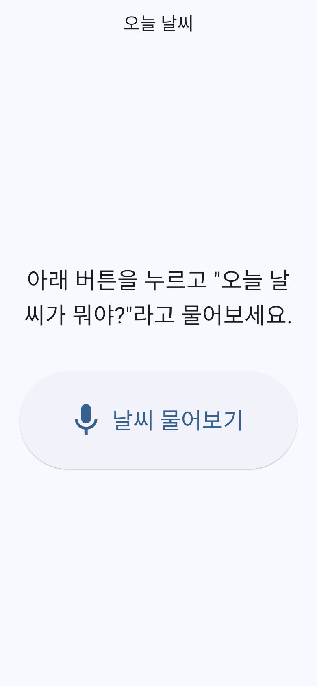 | 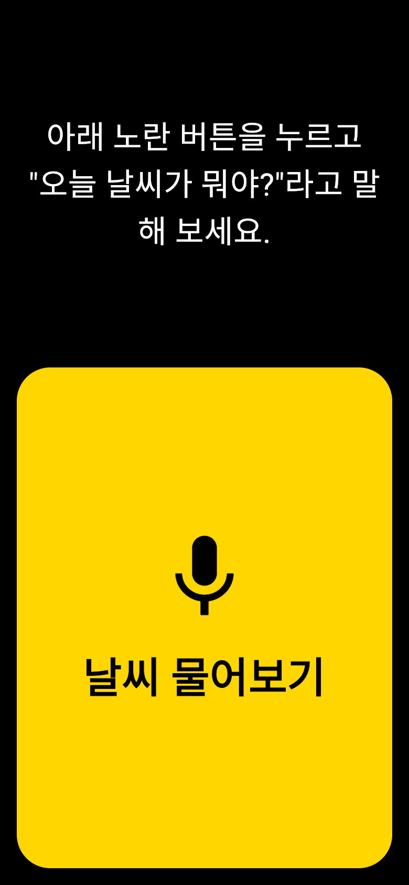 |
| | 흰 배경 + 기본 테마, 보통 크기 버튼 | 검은 배경 + 노란·흰 글씨, 버튼이 화면의 약 60% |
| 2. 버튼을 누르면 | 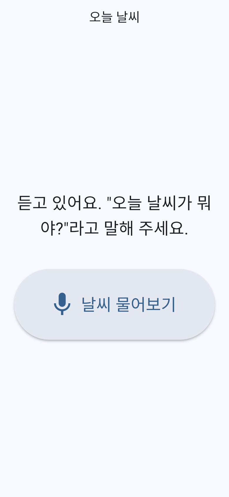 | 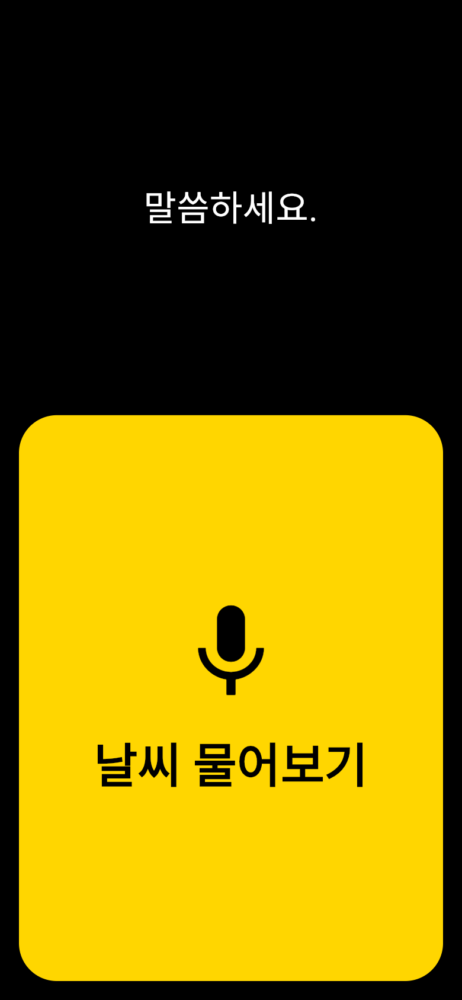 |
| | 화면 글자만 바뀜 (소리 안내 없음) | 🔊 "말씀하세요."를 **소리로** 말한 뒤 듣기 시작 |
| 3. 날씨 확인 중 | 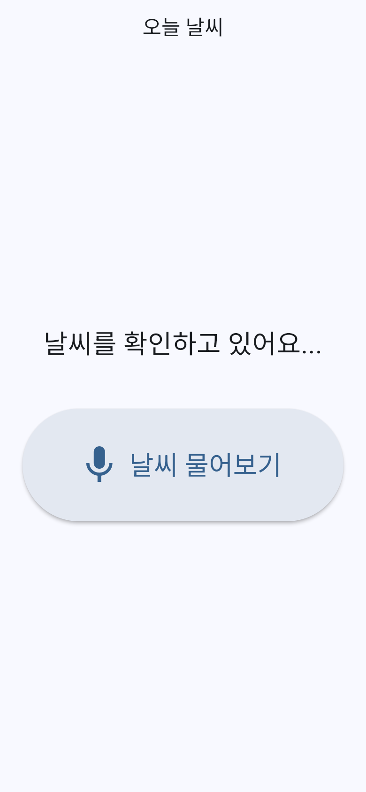 | 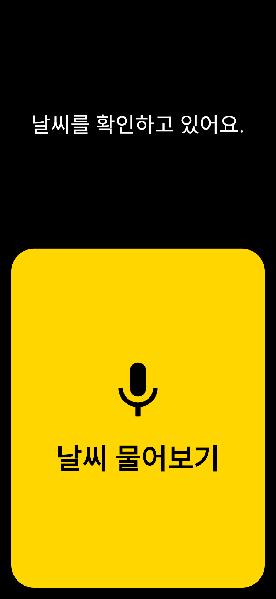 |
| | 인터넷이 느리면 계속 기다림 | 시간 제한이 있어 약 9초 안에 답함 |
| 4. 날씨 답변 | 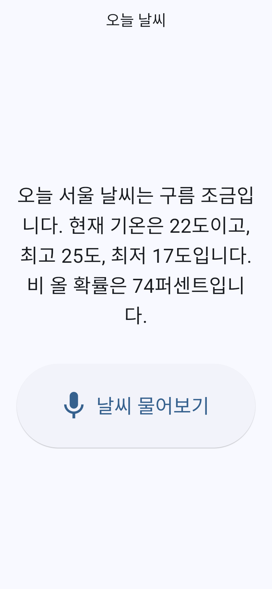 | 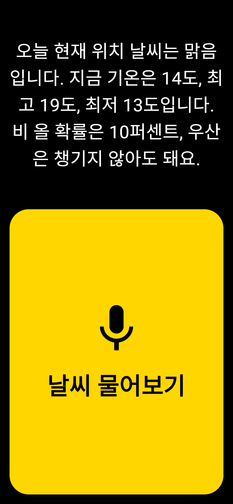 |
| | 항상 **서울** 날씨. 비 올 확률이 74%인데도 우산 이야기가 없음 | **현재 위치** 날씨 + 우산 안내. 글자를 누르면 다시 읽어 줌 |
| 5. 못 알아들었을 때 | 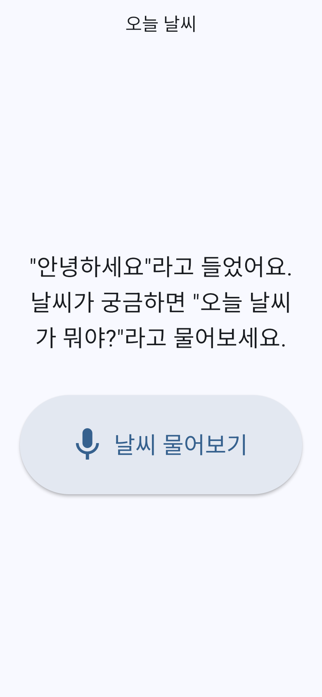 | 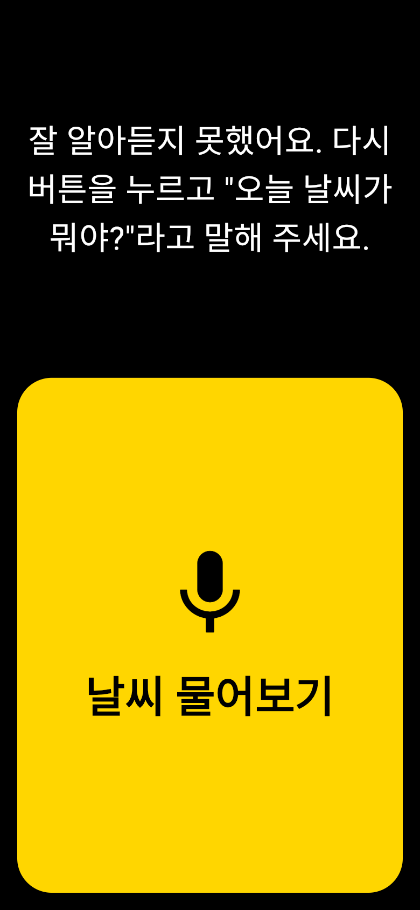 |
| | 들은 말을 그대로 보여 주고 다시 물어보라고 함 | 🔊 다시 버튼을 누르고 말해 달라고 안내 |
| 6. 인터넷 오류 | 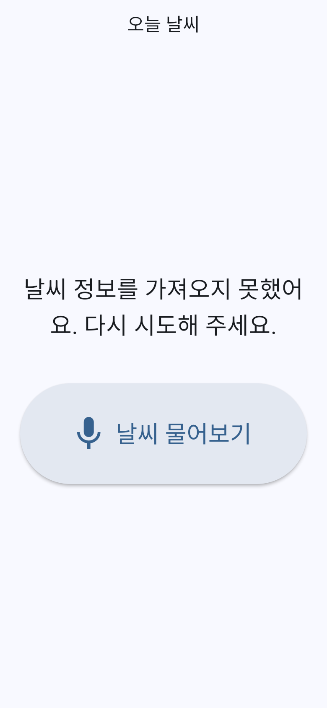 | (화면 사진 없음) |
| | "다시 시도해 주세요." → 무엇을 해야 할지 모름 | "**인터넷 연결을 확인하고** 다시 버튼을 눌러 주세요." |

### 4-2. 버튼을 누른 뒤 달라지는 점

| 상황 | 한 문장 | PRD + Todolist |
|---|---|---|
| 듣기 시작할 때 | 화면 글자만 바뀜 | **"말씀하세요"를 소리로** 말한 뒤 듣기 시작 |
| 결과 문장 | "오늘 **서울** 날씨는 구름 조금입니다… 비 올 확률은 74퍼센트입니다." | "오늘 **현재 위치** 날씨는 맑음입니다… 비 올 확률은 10퍼센트, **우산은 챙기지 않아도 돼요.**" |
| 영하일 때 | "-3도" | "영하 3도" (귀로 듣기 쉬움) |
| 다시 듣고 싶을 때 | 방법 없음 | **결과 글자를 누르면** 다시 읽어 줌 |
| 버튼을 연달아 누르면 | 여러 번 겹쳐서 실행될 수 있음 | 진행 중에는 무시함 |

### 4-3. 문제가 생겼을 때 나오는 안내

| 상황 | 한 문장 | PRD + Todolist |
|---|---|---|
| 인터넷 문제 | "다시 시도해 주세요." | "**인터넷 연결을 확인하고** 다시 버튼을 눌러 주세요." |
| 마이크 권한이 없을 때 | 아무 말 없이 그냥 서울 날씨를 알려 줌 | "**설정 앱에서 마이크와 음성 인식을 켠 뒤**…"처럼 해결 방법을 알려 줌 |
| 위치를 모를 때 | (애초에 서울만 알려 줌) | "위치를 알 수 없어 서울 날씨를 알려드려요."라고 이유를 먼저 말함 |
| 인터넷이 느릴 때 | 계속 기다림 | 시간 제한이 있어서 약 9초 안에 답함 |

### 4-4. 눈에 안 보이는 차이 (화면 읽기 기능)

아이폰에는 화면 내용을 소리로 읽어 주는 기능(VoiceOver)이 있습니다. PRD 버전은 이 기능을 켰을 때 버튼에 "두 번 탭하면 질문을 듣기 시작합니다" 같은 사용법 안내가 붙고,
앱 목소리와 VoiceOver가 같은 문장을 두 번 읽지 않도록 막아 두었습니다. 한 문장 버전에는 이런 처리가 없습니다.

### 4-5. 화면 비교 정리

- **눈으로 보는 일반 사용자:** 차이가 크게 느껴지지 않습니다. 둘 다 버튼 하나 누르고 날씨를 듣는 앱입니다.
- **눈이 불편한 사용자:** 차이가 아주 큽니다. 한 문장 버전은 버튼 찾기, 오류 해결, 다시 듣기가 어려워 사실상 쓰기 힘듭니다.

비유하자면 같은 재료로 만든 요리인데, 한 문장 버전은 "일단 먹을 수 있게 만든 요리"이고 PRD 버전은 "먹을 사람의 사정까지 생각해 차린 상"입니다.

## 5. 과정 비교

| | 한 문장 | PRD + Todolist |
|---|---|---|
| 시작 전 질문 | 없음, 바로 코드 작성 | 열린 질문 4개(위치 모를 때, 듣기 시작 시점, 누가 읽을지, 말 속도)를 먼저 결정 |
| 범위 관리 | AI가 알아서 판단 | "만들지 않는 것" 9개를 정해 범위가 늘어나지 않음 |
| 진행 확인 | 끝나고 한 번에 확인 | 6단계로 나눠 단계마다 확인 후 다음 단계로 |
| 완성 판단 | "돌아가면 완성" | 완성 기준 8개를 하나씩 점검 (실기기 VoiceOver 확인 포함) |
| 기록 추적 | 커밋 메시지만 | 커밋마다 할 일 번호(예: `[5-2]`) → Todolist → PRD 항목으로 거슬러 올라갈 수 있음 |
| 발견한 문제 | — | 점검 단계에서 최악의 응답 시간이 11초로 기준(10초)을 넘는 걸 발견하고 수정 |

## 6. 정리

| | 한 문장 개발 | PRD + Todolist 개발 |
|---|---|---|
| 장점 | 빠르다. 아이디어를 바로 눈으로 확인할 수 있다. | 원하는 사용자에게 맞는 앱이 나온다. 빠뜨린 기능이 없고 왜 그렇게 만들었는지 기록이 남는다. |
| 단점 | AI가 빈칸을 "보통"으로 채운다. 중요한 것(접근성, 위치, 우산)이 빠진다. | 문서를 쓰는 시간이 들고, 개발도 더 오래 걸린다. |
| 어울리는 경우 | 아이디어 시험, 연습용 데모 | 실제 사용자가 쓸 앱, 과제·팀 프로젝트처럼 기준이 있는 작업 |

**결론:** AI는 시킨 만큼 만듭니다. 한 문장은 "무엇을"만 알려주지만, PRD는 **누구를 위해, 왜, 어디까지**를 알려줍니다.
그 차이가 "작동하는 앱"과 "쓸 수 있는 앱"의 차이로 이어졌습니다.
